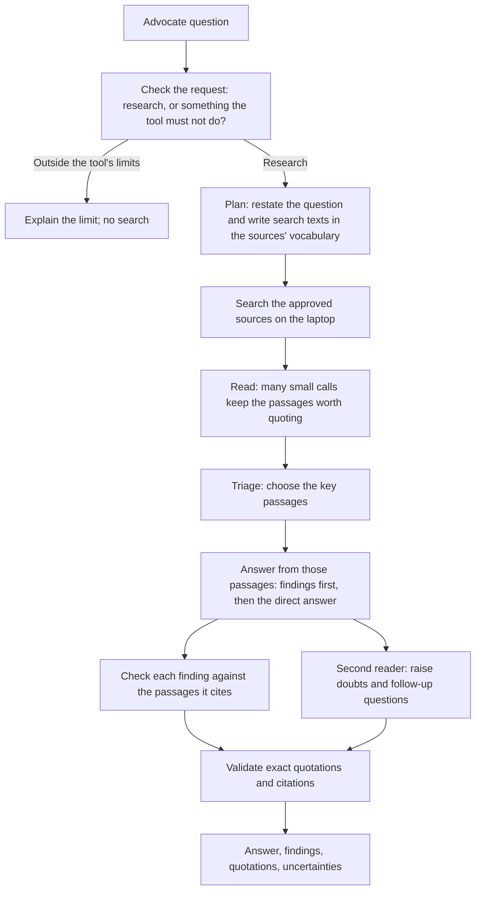

# TRACE

**Trusted Research for Advocates with Citations & Evidence**


**[▶ Watch the demo video](https://github.com/swkarlekar/health-research-oracle-public/releases/download/demo-video-2026-11-08/design_sprint_demo_video.mov)** (MOV download, 119 MiB; recorded on an earlier version)

A research assistant for public health insurance advocates, based on the Community Service Society of New York (CSSNY) design brief. Ask a question in plain language, read the answer with its supporting quotations, see what the sources leave uncertain, and open any cited document inside the chat with the passage highlighted. The advocate remains responsible for interpreting the rules and applying them to a client's situation.


**This prototype focuses on New York Medicaid**, especially managed long term care, managed care, and non-MAGI eligibility. The collection also holds some Medicare, integrated Medicare–Medicaid, and health-privacy sources; their presence does not mean those topics are fully covered.

## Start the demo

You need Python 3.12+, Git, AWS CLI v2, Make, Google Chrome, and an AWS SSO profile with Bedrock permissions. No GPU is required. See [first-time AWS and tool setup](README-technical.md#first-time-setup) if these are not configured.

```sh
aws sso login --profile oracle

git clone https://github.com/swkarlekar/health-research-oracle-public.git
cd health-research-oracle-public
make setup
make run
```

`make setup` installs a small Python runtime and downloads and verifies the 364 MB [data release](https://github.com/swkarlekar/health-research-oracle-public/releases/tag/data-2026-11-11-paragraphs): documents, PDFs, search indexes, and an optional document map. It does not download an LLM or create AWS resources. `make run` opens the local page in Chrome. Keep the terminal running; Ctrl+C stops the server.

Open **⚙ Model settings**, check your AWS account, and explicitly authorize a spending allowance before asking a question. Opening the app or saving a model choice does not authorize paid calls. Each collaborator uses their own AWS account; no keys are shared with the project.


## Using the workspace

- **Look up a source.** The sidebar's **Documents** tab lists all 81 sources by type, filters by title as you type, and searches the text of every source (press `/` to jump to the box). Opening a document shows it in the same viewer used for citations, with find-in-document and match navigation. Sources cited in the current chat are listed first. Lookup is entirely local and never calls AWS.
- **Ask a research question.** The sidebar offers the four client reference cases, five boundary tests, and 15 synthetic examples. Follow-up questions can build on your earlier questions; earlier generated answers are never treated as evidence.
- **Read the answer and its evidence.** Each response leads with a direct answer, then findings that each name their source, then the exact quotations. Click a citation to open the document with the text highlighted.
- **Read the uncertainties.** Under each answer the tool lists what the sources leave open: wording that can be read two ways, exceptions that might apply, sources that disagree, and things the sources do not address, each with a follow-up question. It is designed to raise a doubt rather than hide one.
- **Choose the models.** By default Qwen3 32B on Amazon Bedrock plans the search and screens passages, and Mistral Large 3 writes the answer. Settings also offers Nova Lite and Nova Pro, or a model already installed in Ollama, LM Studio, or another local server.
- **Inspect a run.** **View debug report** shows every step: the search plan, the passages read, the instructions given to the model, and what each step returned.


Screenshots are from an earlier version of the interface.

## How the harness works

A model answers well from a dozen clean passages and badly from fifty mixed ones, and the passage that answers a question is usually written in words the advocate did not use. The harness is built around getting the right dozen passages in front of the model, then checking what it wrote.



Models only ever return passage identifiers; the program resolves each one to exact source text, so a quotation cannot be invented. Searching runs on your laptop over the downloaded indexes. Answer generation sends the question and selected source text to Amazon Bedrock. [How the harness works](docs/harness.md) describes each step, and [the prompts](docs/prompts.md) shows the instructions.

## Current limits

This is a research prototype, not a validated legal advice system. On the four client reference cases the answers reach the expected conclusion with the expected sources in most runs, but they were judged by the developers, not by a legal reviewer, and the same question can produce somewhat different supporting passages from one run to the next. A matching quotation and a passed support check do not prove an answer is legally correct or complete.

Research is limited to the supplied sources: 81 documents, about 7,000 searchable passages. The tool does not verify that a source is current, and some sources contain old figures. Do not enter client identifiers, and do not ask the tool to access private case records, decide whether an individual's rights were violated, guarantee an outcome, or recommend client-specific action.

## Further reading

- [How the harness works](docs/harness.md): each step of the pipeline and its settings.
- [The prompts](docs/prompts.md): the instructions behind each step.
- [Technical README](README-technical.md): AWS setup, permissions, storage, spending controls, and developer commands.
- [Chat and document viewer](docs/local-interface.md).
- [Data release and verification](docs/data-bundle.md).
