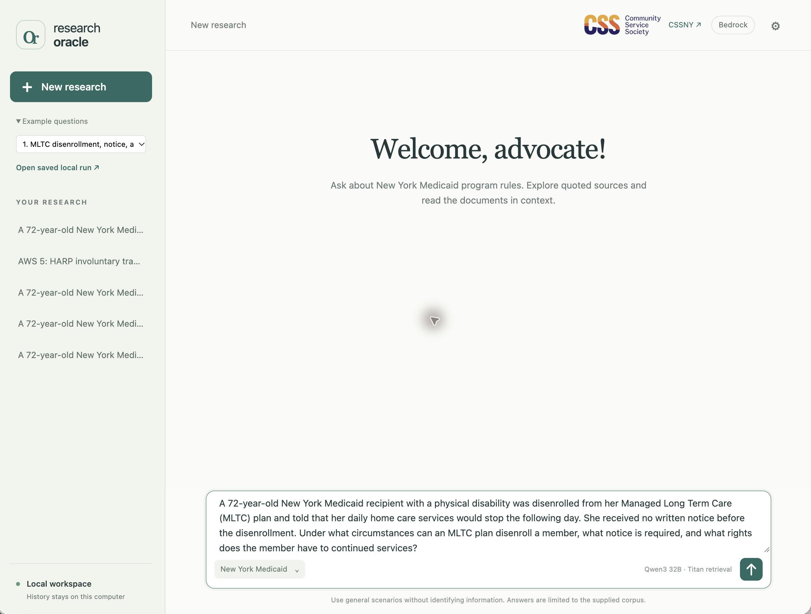
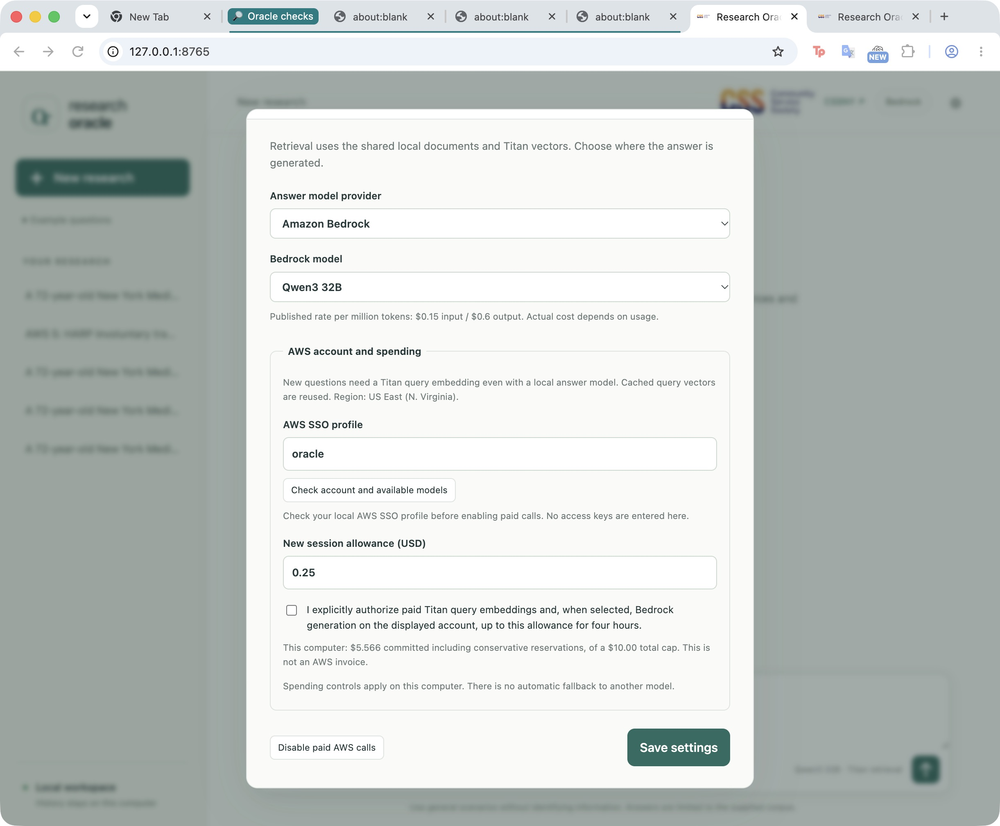
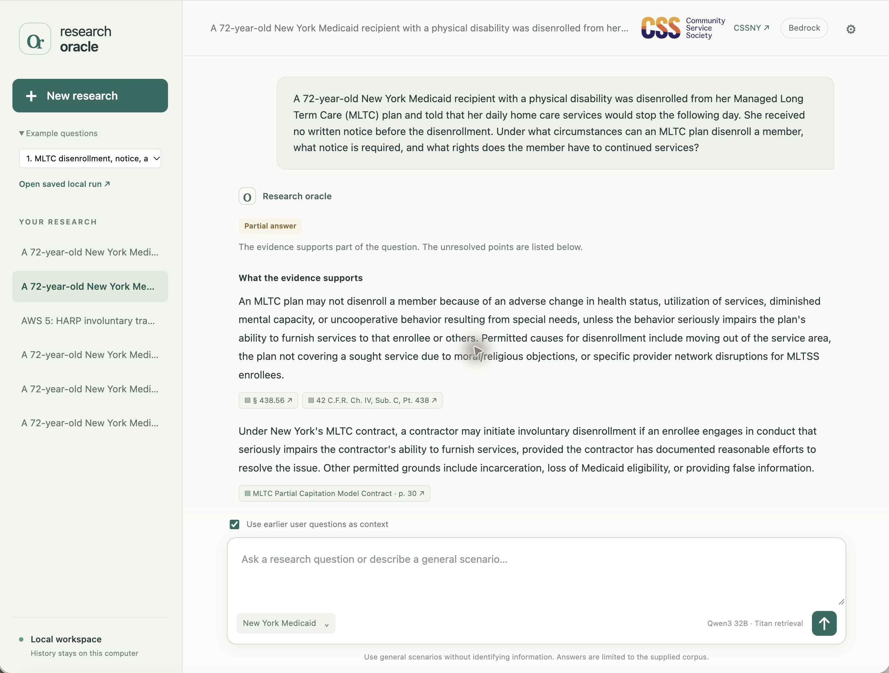
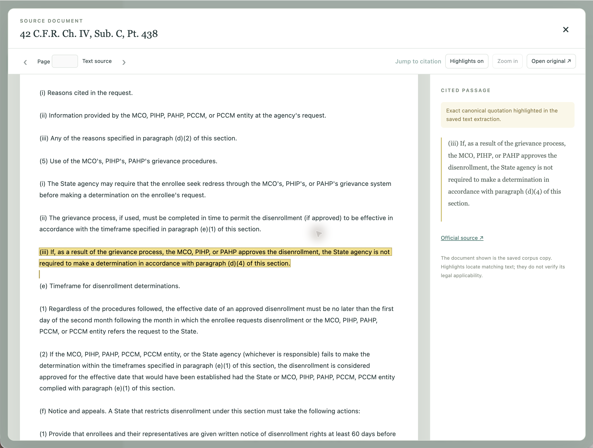
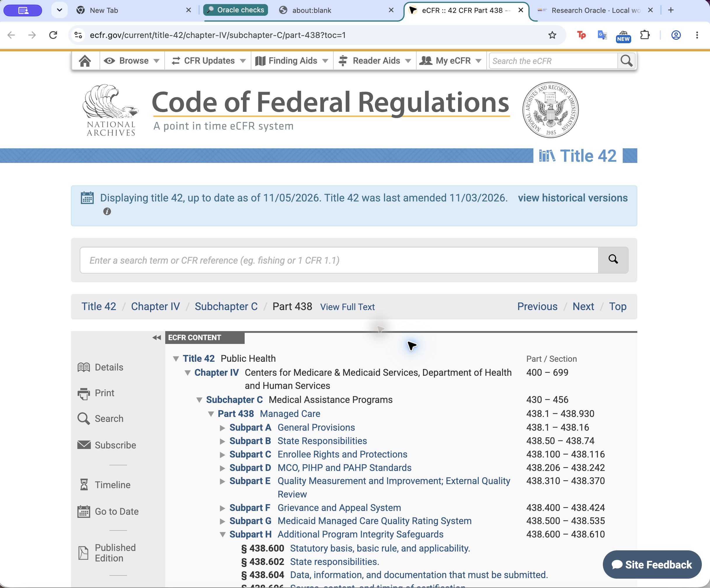
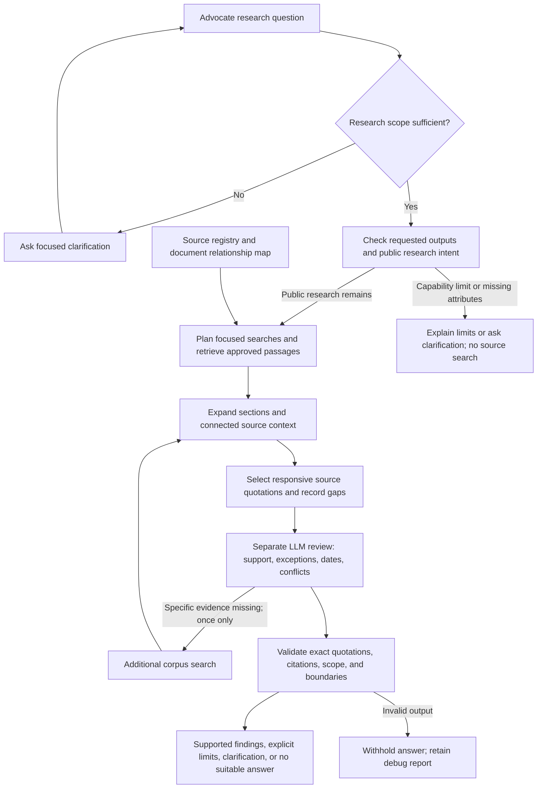

# TRACE

> Experimental prompt/harness candidate. This branch is available for inspection and retesting; it is not enabled in the default `main` demo. Final tests found wrong-program, relevance, and completeness failures. See the [evaluation and exact outputs](docs/advocate-optimization.md).

**Trusted Research for Advocates with Citations & Evidence**


**[▶ Watch the demo video](https://github.com/swkarlekar/health-research-oracle-public/releases/download/demo-video-2026-11-08/design_sprint_demo_video.mov)** (MOV download, 119 MiB)

A research assistant for public health insurance advocates, based on the Community Service Society of New York (CSSNY) design brief. Ask a question in plain language, inspect the supporting quotations, and open cited documents inside the chat interface with highlighted passages. The advocate remains responsible for interpreting the rules and applying them to a client's situation.



The broader design covers public health insurance. **This prototype focuses on New York Medicaid**, especially managed care, long-term care, and non-MAGI eligibility. The supplied resources also include Medicare, integrated Medicare–Medicaid care, and health information privacy; their presence does not establish complete coverage of those topics.

## Start the demo

You need Python 3.12+, Git, AWS CLI v2, Make, Google Chrome, and an AWS SSO profile with Bedrock permissions. No GPU is required for the default cloud model. See [first-time AWS and tool setup](README-technical.md#first-time-setup) if these are not configured.

```sh
aws sso login --profile oracle

git clone https://github.com/swkarlekar/health-research-oracle-public.git
cd health-research-oracle-public
make setup
make run
```

`make setup` installs the small Python runtime and automatically downloads and verifies the roughly 208 MB [data release](https://github.com/swkarlekar/health-research-oracle-public/releases/tag/data-2026-11-08): documents, PDFs, document vectors, and relationship map. It does not download an LLM or create AWS resources. `make run` opens the local page in Chrome. Keep the terminal running; Ctrl+C stops the server. On subsequent visits, sign into AWS and run `make run` from the project folder.

Open **⚙ Model settings**, check your AWS account, select a model, and explicitly authorize a small spending allowance before asking a new question. Merely opening the app or saving a model choice does not authorize paid calls. Each collaborator uses their own AWS account; no keys or credentials are shared with the project.

**Model settings and spending controls**



Paid calls are disabled in this screenshot. The displayed ledger is this developer workspace’s recorded trial usage; a new installation creates its own ledger.


## Using the workspace

- **Ask a research question.** The sidebar starts with four advocate cases, with original and simplified wording where supplied, followed by 15 substantive synthetic examples and five boundary tests. Follow-up questions can use earlier user messages; previous generated answers never become evidence.
- **Choose where the answer is generated.** The default is **Qwen3 32B on Amazon Bedrock**. Settings also lists Amazon Nova Lite and Nova Pro, or discovers already installed models in Ollama, LM Studio, and other local OpenAI-compatible servers. Discovery does not load or download a model. Local inference needs enough memory and may be slow on a CPU.
- **Choose a historical date.** Expand the research scope and set **Rules as of** to the date whose rules you want researched—for example, a past notice or coverage period. Leave it blank if unspecified. The system checks document dates and applicability; the date does not supply a missing historical edition or guarantee that the collection establishes the rules then in force. Plan type is inferred from the question, with clarification when needed.
- **Read the evidence.** Responses show supported findings, exact quotations, citations, and unresolved gaps. Click a citation to browse the saved document and highlighted text. **View debug report** shows retrieval, context expansion, relationship leads, model instructions, review results, usage, and validation failures. Private chain-of-thought is not requested or recorded.

**Example answer and highlighted source**



This historical saved result illustrates the interface. It contains known applicability errors and is not a validated legal answer.



This example shows a saved text source. PDF sources open in the paginated viewer; highlights locate text and do not establish legal applicability.

**Open the official source**



The official-source link opens the publisher’s website separately from corpus-grounded research.


Document retrieval and the relationship map run on your laptop. **New query vectors still use AWS Titan**, even when the answer model is local; identical cached queries reuse their vectors. Bedrock generation sends the question and selected source context to AWS. Local generation sends that context only to the selected loopback model server. The demo has no hosted server or offline chatbot mode. [Storage, privacy, costs, and model setup](README-technical.md) explains the details.

## How the harness works

The harness surrounds the LLM with source selection, context, review, and quotation checks. This is the implemented flow corresponding to the [original diagram](mermaid-diagram.png):



Two query-only LLM checks separate public-rule research from requests for private access, guarantees, or individual conclusions and plan focused searches. Mixed requests can continue with explicit capability limits. Retrieval combines Titan vector candidates with local text matches. The LLM selects a small set of verbatim passages, followed by a separate review of responsiveness, program/plan applicability, exceptions, dates, and conflicts. Rule content is displayed as source quotations; generated text identifies evidence gaps and capability limits. The map provides documentary links and version leads. Dates embedded in source text take priority. Allowed last-modified metadata embedded in a document is only a labeled secondary proxy, never proof that a rule became effective or replaced another rule. Unresolved conflicts and missing evidence remain visible.

For a concrete look at the instructions, see **[prompt examples and the actual prompt sources](docs/prompts.md)**. For example, the reviewer is told: “Newer documents do not automatically supersede older ones. Require explicit documentary language for any version relationship.”

## Current limits

This is a research prototype, not a validated legal advice system. Matching quotations and a favorable LLM review do not prove legal correctness or completeness. Testing has found missed conditions, wrong-program applicability, unsupported conclusions, and operational rejections. The [latest advocate-case optimization](docs/advocate-optimization.md) replaces free legal paraphrases in the UI with reviewed verbatim source findings and adds focused hybrid retrieval. This reduces one source of unsupported statements but does not guarantee that selected passages answer the question.

The [earlier advocate-case baseline](docs/advocate-comparison.md) returned no substantive cited answers. The [optimization report](docs/advocate-optimization.md) preserves those failures, subsequent experiments, final retests, and remaining limitations. Some supplied reference answers depend on policies absent from the fixed corpus; TRACE must state that gap rather than invent the rule.

The current package contains **58 evidence-producing documents and 4,572 chunks**, from 108 source records; 26 acquired indexes are excluded from evidence retrieval and 24 targets were unavailable. Research is limited to the supplied sources. Do not enter client identifiers or ask the system to access private case records, decide an individual violation, guarantee an outcome, or recommend client-specific action steps.

## Further reading

- [Technical README](README-technical.md): AWS SSO, permissions, SQLite/vector storage, developer commands, and spending controls.
- [Prompt examples](docs/prompts.md) and [prompt-search findings](docs/prompt-search.md).
- [Advocate question baseline](docs/advocate-comparison.md) and [current optimization results](docs/advocate-optimization.md): original and simplified questions, source gaps, actual responses, timing, and cost.
- [Chat and document viewer](docs/local-interface.md).
- [Data release and verification](docs/data-bundle.md), including the [public distribution audit](docs/publication-audit.md).
- [Local vector retrieval and AWS comparison](docs/local-vectors.md).
- [Architecture](docs/architecture.md), [validation record](docs/validation.md), and [code cleanup review](docs/code-review.md).
