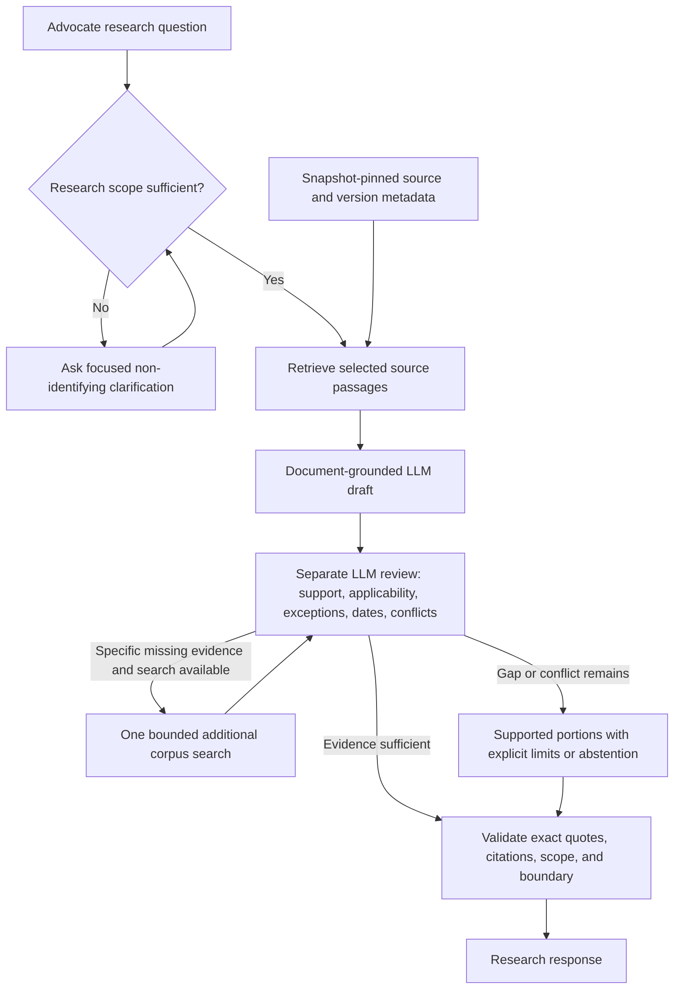

# Architecture and acceptance criteria

The existing release's `research.py` owns canonical source text, source metadata, quotation offsets, schema validation, and hyperlink rendering. `oracle/corpus.py` adds source selection enforcement and version/date search leads without rewriting that release. `oracle/harness.py` orchestrates the bounded state machine. `oracle/providers.py` implements local model access. `oracle/aws.py` provides optional gated boto3 adapters and a local export.

## Selected demo architecture

The demo uses Amazon Titan Text Embeddings V2 (`amazon.titan-embed-text-v2:0`) document vectors exported from the completed AWS trial, supplemented by directly embedded new chunks using the same settings. Local exhaustive cosine search and SQLite full-text search contribute bounded candidate lists, fused by reciprocal rank. Results resolve canonical source identities, then use the same SQLite context and relationship map. New questions still use AWS Titan query embeddings unless cached. Settings chooses Bedrock Qwen3 32B by default or an installed local response model; explicit account/model-specific consent is required for paid calls. No hosted vector database is required for normal use. The sanitized public data Release restores documents, vectors, and graph on each laptop. See [retrieval details](local-vectors.md) and [the technical README](../README-technical.md).

```mermaid
flowchart LR
    Q[Advocate question] --> R[Local hybrid search: Titan vectors and SQLite keywords]
    R --> I[Resolve stable chunk and document IDs locally]
    I --> E[Expand to complete section or short document]
    E --> G[Follow reviewed amendment and clarification relationships in local SQLite]
    G --> P[Assemble canonical evidence within a context budget]
    P --> D[Selected Bedrock or local LLM draft]
    D --> V[Selected LLM review and bounded additional retrieval]
    V --> C[Python quotation, citation, scope, and response validation]
```

The optional managed adapter uses the standalone `Retrieve` operation, then calls the generation model separately. That leaves application-controlled steps between similarity retrieval and generation; AWS documents this decoupled workflow in [Knowledge Bases retrieval](https://docs.aws.amazon.com/bedrock/latest/userguide/kb-how-retrieval.html).

Titan maps text to vectors. It does not need to understand or store the relationship graph. Stable source identifiers connect the vector search results to the canonical text and graph. Keep relationship edges, evidence quotations, applicability conditions, date bases, and review statuses in local SQLite. Keep vector metadata small; do not serialize the whole graph into each chunk's metadata. A larger relationship graph can be used without changing the embedding model, although graph traversal and expanded context still require limits and evaluation.

Expansion should load a complete short source where practical, or the relevant section with definitions, qualifications, table headers/footnotes, and referenced provisions for longer sources. Follow reviewed links to amendments and clarifications, bringing their supporting source passages into the evidence packet. Newly added passages retain canonical identities and quotation offsets. A model-generated relationship remains a candidate until its evidence and review status justify its use; metadata last-modified proxies never establish supersession by themselves.

Perform this expansion in our Python harness instead of depending on managed hierarchical chunking. AWS [advises against hierarchical chunking with S3 Vectors](https://docs.aws.amazon.com/bedrock/latest/userguide/kb-chunking.html) because large parent contexts can exceed metadata limits. Prechunked source files with `NONE` chunking preserve the current citation identities, while larger parent text is loaded separately by our application.

For the demo, canonical sources, context, relationships, and document-vector retrieval stay on the laptop. The earlier authorized trial exercised S3, Titan, Bedrock Knowledge Bases with S3 Vectors, and Bedrock generation; temporary resources were deleted after vector export/restore testing. The historical vector-only local and saved managed searches returned identical top-K chunk sets on the original 15 questions, with order differences in three. That result does not establish equivalence for the new keyword fusion or future queries. Lambda, Neptune, and managed GraphRAG are unnecessary for this demo. Tests and prompts do not establish legal correctness; see [prompt-search findings](prompt-search.md).

## Acceptance mapping

| Requirement | Implementation | Remaining evaluation |
| --- | --- | --- |
| Identify trusted, applicable sources | Snapshot-pinned user-selected registry; exact URL/raw-hash checks; reviewer applicability check | Source selection alone does not establish authority; reviewed program/jurisdiction tags would improve retrieval |
| Clear answers or explicit no-answer | Separate draft and review; qualified result states; no-hit short circuit | Advocate-authored questions and reference answers |
| Verbatim quotations and hyperlinks | Canonical Unicode offsets and source URLs; invalid spans/IDs rejected; whole-excerpt fallback | PDF layout-sensitive passages need visual/source review |
| Focused clarifying questions | Scope gate plus model/reviewer questions; `unknown` supported | Evaluate unnecessary clarifications and PII paraphrases |
| No PII solicitation or client-specific advice | General-question input boundary, policy prompts, independent review call, conservative output rules | Adversarial and expert review; no complete automatic guarantee |
| Outdated documents/addenda/conflicts | Reviewer sees date/relationship leads and evidence; one additional corpus search; uncertainty states | Exhaustive version discovery and expert-labeled cross-document cases |
| Documentary evidence alone | No model tools; no browser or external search adapter in the runtime; source content is untrusted evidence | Evaluate pretrained-knowledge leakage and prompt injection |
| Tight budget | Paid calls disabled until explicit account/model consent; per-session allowance and persistent $10 per-computer ledger; bounded context/output and no retries | App controls are not account-wide billing enforcement; model quality remains separately evaluated |

## Version handling

The processor already records document date mentions, relationship phrases, file dates, uncertainty flags, and provenance. These are preserved rather than collapsed into a single `last_updated` field. The reviewer prefers relevant dates in source text. Per the client's instruction, if the text does not establish dates, the document metadata's last-modified value can be used as a secondary proxy. Every proxy the reviewer declares is checked against the canonical metadata, shown with its raw value, and added as an explicit qualification. A proxy does not itself establish a governing legal effective date, amendment, clarification, or supersession. The reviewer cannot use a legal-precedence rule from memory to settle a conflict.

A document-level relationship signal can trigger the additional corpus search. It cannot itself support a cited conclusion: the exact supporting passage must be in the evidence packet. If no passage or clear relationship can be established, the response retains the gap. Human resolutions in the original harness remain labeled interpretations, distinct from documentary facts.

The local review is bounded by retrieved/expanded excerpts and at most sixteen documentary signals totaling 9,000 JSON characters per document and 16,000 signal characters overall. Context expansion has separate unit/total limits and a one-hop graph traversal cap. This is a cost/context safeguard, not evidence that the remaining corpus lacks a conflicting statement. Future evaluation must measure the quality of managed semantic retrieval, applicability, version-family resolution, and linked addenda on expert-reviewed queries.

## Before advocate use

Obtain an expert-reviewed set covering answerable, unanswerable, ambiguous-plan, historical-period, amendment, exception, conflicting-source, malicious-document, PII, and personal-advice cases. Score retrieval recall, substantive support, exception coverage, quote/citation accuracy, correct abstention, clarification quality, boundary compliance, latency, and tokens/cost. Test every candidate model on the same cases. Passing software tests is not a substitute for this evaluation.

## Customer response and diagnostic views

`demo` and `ask` render a concise answer by default. `--debug-output` writes an opt-in local diagnostic report from the same execution; `--view debug` selects that report as the primary output. The observer records retrieval rounds, exact canonical evidence, the evidence actually supplied to each model, graph leads and omissions, source/date signals, public draft/review conclusions, validation events, model usage, and rejection reasons. It distinguishes connected documents from loaded text. It does not request or collect private chain-of-thought, raw provider responses, credentials, or HTTP headers. Debug files include query and source text and belong under ignored `artifacts/`.

For generation, each source excerpt is represented losslessly as labeled passages. The generation schema accepts only these quotation IDs. Python resolves each ID into canonical Unicode offsets and applies the existing independent span/citation validator; citation pages are derived from the selected quote's canonical sections rather than the parent excerpt's first page. The original packet and rendered-result contracts retain numeric source spans. This selector protocol is shared by Ollama and Bedrock Converse and is covered by the mocked AWS SDK flow. The API-only simulation is named `api-check` and explicitly disclaims actual inference or embeddings.
