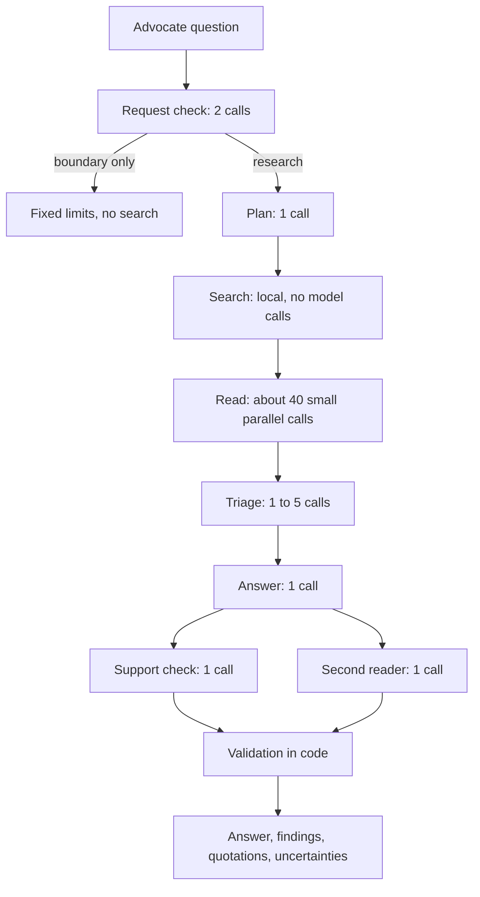

# How the harness works

The harness is the program around the language model. It decides what the model reads, asks it narrow
questions one at a time, and checks what comes back. This page describes the pipeline used for Bedrock
answers (`oracle/pipeline.py`). Its instruction texts are in `oracle/pipeline_prompts.py`, shown with
commentary in [the prompts](prompts.md), and its settings are in `config/research-pipeline.json`.

## Two observations the design rests on

1. **The source that answers a question rarely uses the advocate's words.** An advocate asks about
   "network adequacy"; the regulation says "sufficient in number, mix, and geographic distribution". An
   advocate asks which plan pays; the statute speaks of "the legal liability of third parties". Searching
   with the question as typed misses these.
2. **A model answers well from a dozen clean passages and badly from fifty mixed ones.** Given a long,
   mixed context it merges similarly named rules and leads with whatever is most on-topic rather than most
   on-point.

So most of the pipeline exists to put the right dozen or so passages in front of the model that writes the
answer, and the rest exists to check what it wrote and to surface doubt.

## The steps

| Step | What it does | Why |
|---|---|---|
| **Request check** | Two calls that see only the question. They separate public-rule research from requests the tool must decline: private case access, guaranteed outcomes, individual verdicts, unverified accusations. A question that is only the latter gets a fixed explanation and no search. | Keeps the tool inside research. |
| **Plan** | Restates the question without the story, lists one to three issues, five to eight legal terms of art, six to eight one-sentence imitations of how a source would state the rule, key phrases, and likely documents from the catalog. A short glossary maps advocate shorthand (SNF, UAS-NY, TPHI) to source vocabulary. | Bridges the vocabulary gap. |
| **Search** | Runs every planned search text through five local lanes: paragraph vectors limited to the core authorities for the plan type plus the planner's picks, paragraph vectors over everything, chunk vectors, chunk keywords, and stemmed paragraph keywords. Results are rank-fused into a pool of 120 chunks. Documents written for another program or plan type are down-weighted. | Paragraph-level indexes find a sentence buried in a long chunk. Always searching the governing contract, the federal managed care rules and the State plan statute finds the general duty behind a narrow question. |
| **Read** | Splits each chunk into numbered passages and asks, in batches of six chunks, which passages a careful researcher would keep, graded 3 (answers the main issue) or 2 (a general governing rule, a definition, a later issue). Each source carries a label with its kind of authority and a flag if it belongs to another program. The first 60 chunks are read twice in different groupings and the results merged; chunks adjacent to a hit are read once. If any part of a table is kept, the whole table is. | Each call is easy and cheap. Screening varies from run to run, so the second read is there for recall. |
| **Triage** | From the kept passages, names the one to three needs the answer must resolve and picks up to 20 passages to rest it on, across levels of authority. Evidence longer than one prompt is triaged in batches, with a final pass over the batches' picks. | Narrows to what the writer can reason over well. |
| **Answer** | Sees only the picked passages and the needs. Writes the findings first (one rule per finding, naming the kind of source), then a short basis, then the direct answer. | Writing the conclusion after the findings keeps the answer consistent with them. |
| **Support check** | Compares each finding with the passages it cites: supported, overstated (rewritten to what the passage says), or unsupported (dropped). It cannot change the answer. | Removes claims the sources do not make. |
| **Second reader** | Reads the question, the draft answer and the picked passages, and raises up to three doubts: wording that can be read two ways, an exception that touches the situation, sources that disagree, a rule written for a different actor, something the advocate asked that no passage addresses. Each comes with a follow-up question. | An answer that hides a doubt is worse than one that flags it. This is kept separate from the writer so that looking for doubt does not pull the answer off the question. |
| **Validation** | In code: every passage id is resolved to exact text in the pinned corpus, unknown ids are discarded, the scope must be unchanged, and prose that reads as advice to a client is removed. Invalid output is withheld. | A quotation cannot be invented. |

The response lists the direct answer first, then the findings, then up to 26 quotations: those the answer
cites, those the second reader points to, and other key passages the answer did not use. Showing a little
too much is preferred to leaving out a relevant source. Any doubt or gap marks the answer as qualified.

## Models

Two models can share the work. The model selected in Settings does the plan and the reading, which is most
of the calls. An optional second model writes triage, answer, support check and second reader. The default
pairing is Qwen3 32B for the first and Mistral Large 3 for the second: screening does not benefit from the
stronger model, and the final reasoning does. If the second model is not enabled, the selected model does
everything.

## Settings

`config/research-pipeline.json` holds what can be changed without touching code:

- `glossary`: advocate shorthand mapped to source vocabulary. Names only; nothing in it is evidence.
- `core_documents`: for each plan category, the documents that are always searched.
- `authority_rules`, `in_scope_families`, `authority_order`: how a document title becomes a label such as
  "Federal Medicaid regulation", which documents count as another program's, and the order evidence is
  presented in.
- `limits`: pool size, how much of the pool is read twice, batch sizes, the evidence budget, the number of
  key passages and of displayed quotations.
- `lane_weights`, `rank_constant`, `off_scope_weight`: how the search lanes are fused.

## What the pipeline does not do

- It does not check whether a source is current.
- It does not use the optional document map. Following the map's references is available as a setting
  (`limits.reference_cap`) and is off, because it did not improve results.
- It does not verify legal correctness. The support check compares findings with their own passages only.
- It is not deterministic. The same question can keep or drop a supporting passage from one run to the next.

## The original loop

Local models, keyword-only retrieval, and the command line use the earlier, simpler flow in
`oracle/harness.py`: one search, bounded expansion to surrounding context and, optionally, documents linked
in the document map, a draft, and a skeptical review that may request one more search. It makes four or five
model calls and suits small local models. Its instructions are `text_corpus/config/document_only_system.txt`
and `REVIEW_POLICY` in `oracle/harness.py`.
