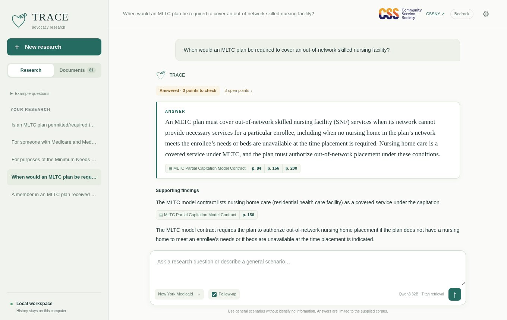
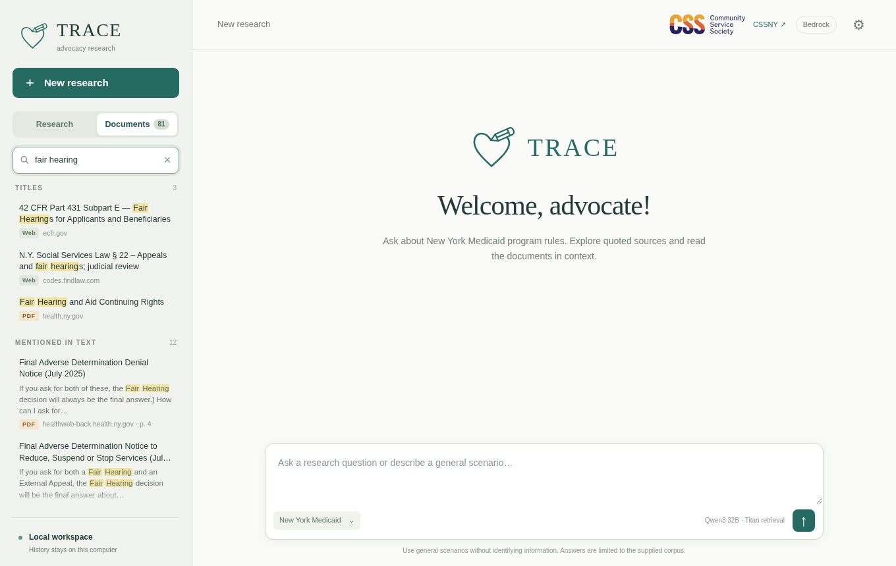
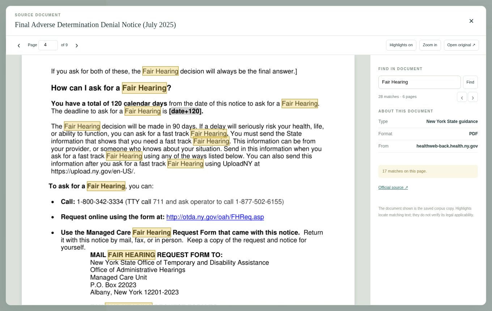
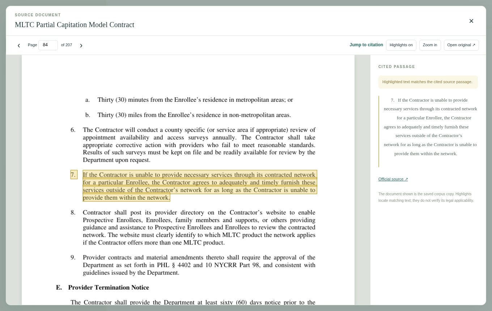

# Local chat and document viewer

Run `make setup` once, then `make run`; the launcher opens the page in Google Chrome. See the
[main README](../README.md) for prerequisites and AWS sign-in. Nothing is hosted by the project: the server
binds only to your own computer, and one research run is accepted at a time.

## Settings

**⚙ Model settings** chooses where answers are generated. Amazon Bedrock is the default, with Qwen3 32B
planning and screening and, if its box is ticked, Mistral Large 3 writing the answer. Nova Lite and Nova
Pro are alternatives, and models already installed in Ollama, LM Studio or another local server can be used
instead. Model discovery reads metadata only; it never loads or downloads a model.

Before any paid call you check the AWS account and explicitly authorize a session allowance. The page
shows what was approved, when it expires, and the per-computer spending total, and it can disable paid
calls. See the [technical README](../README-technical.md#model-settings-and-spending).

## Asking

Type a question or pick one from **Example questions** on the sidebar's **Research** tab: the four client
reference cases, five boundary tests, and 15 synthetic examples. Plan type is inferred from the question.
Expand the scope button to change the program. The **Follow-up** switch beside the scope button controls
whether earlier questions in the same conversation are used as context; earlier generated answers are never
used as evidence. Conversations are stored locally in `artifacts/ui/history.sqlite`.

## Reading an answer

While a question is running, a step tracker shows which stage is in progress. A completed answer has:

- a status above the answer that says what is open ("Answered · 3 points to check", "Answered in part") and
  links to **What remains open**;
- the direct answer in its own card, with one chip per source and a button for each cited page;
- supporting findings, each with its sources, and the supporting quotations;
- **What remains open**: wording that can be read two ways, exceptions, disagreeing sources and things the
  sources do not address. Where a person can settle the doubt, the point ends with a bold **To verify**
  question for a supervisor, the Department or the plan. These are questions for people, not for the tool;
- **More information needed**: shown only when the request is missing something, such as the program.

**View debug report** opens the full record of a run: the search plan, the passages read, the instructions
and inputs for each model call, each call's structured output, token usage, and timings. Failed runs keep
their diagnostics and withhold the rejected answer.

## Looking up documents

The **Documents** tab lists every approved source, grouped by type, with a Web or PDF tag and the publisher's
host. Cleaned titles replace the raw corpus titles (for example `42 CFR 438.71 — Beneficiary support system.`).
The search box does two things at once: it filters titles, and it searches the text of every source with the
local keyword index, showing the best passage and page for each source. Press `/` to focus the box; arrow
keys move through results and Enter opens the first. Lookup uses only local data: no AWS call, model or
embedding is involved, and unapproved sources are never listed.

Sources cited in the open conversation are listed first, with the number of quoted passages, and open at the
quoted passage with it highlighted.

## Viewing a source

Click a page button on a citation, or a document in the Documents tab, to open the saved source inside the
page. From a citation the viewer scrolls to the quotation and marks it with a yellow overlay (partial
matches are labelled, because extraction and page layout can differ). Opened from the Documents tab, there is
no cited passage; use **Find in document** to mark every match of a word or phrase and step through them.
PDFs show page images with highlight overlays; other sources open in a plain text view, and saved web pages
are never executed. A highlight shows where the text is, not whether it applies.

The viewer's official-source link opens the publisher's own site in a separate tab. That site is not
searched by the tool.

## Narrow screens

Below about 750 pixels the sidebar becomes a drawer behind the menu button, and source chips stack their page
buttons under the title.
